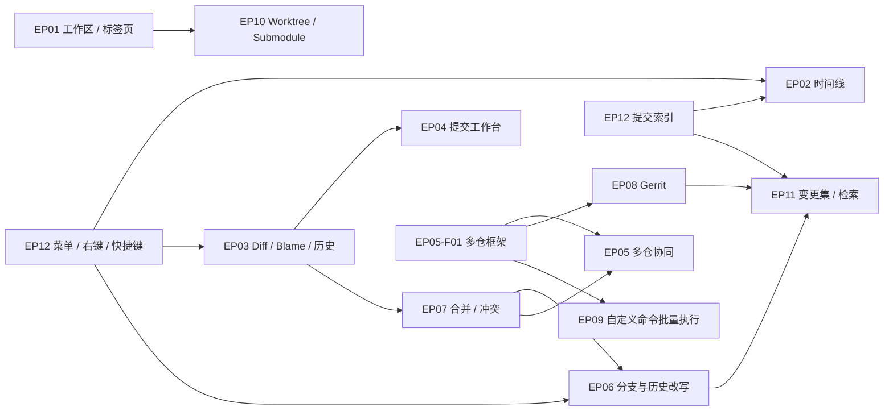

# GitSpace 功能缺口与规划（Epic 总览）

| 文档信息 | 说明 |
|---|---|
| 版本 | v1.1（2026-11-01）：优先级口径统一为 P0/P1 两级，排期与优先级分离，逐项标注实现状态；v1.0（2026-10-31）初版 |
| 状态 | Draft，待评审 |
| 依据 | MRD（文件 v2.0，文档头 v1.5）；TechStack v1.0（含 v1.1 变更）；`docs/func/GitSpace-Features-v1.0.md`；`repos/GitSpace` 代码盘点（2026-10-31，Story-1031 后更新）；[Fork 与 IDEA 调研](./research-fork-idea.md) |
| 范围约定 | 本目录不修改 MRD。MRD 已承诺但未实现的标「P0」；MRD 之外的新增建议标「P1（待评审）」，回写建议见 §8 |

## 1. 结论

1. **口径已统一**：优先级只有 P0 / P1 两级；原「批次 A/B/C」「工作包 A1–A3」「P0 补齐 / P1 / P2 / 待评审」全部退役，映射见 §2。排期（M1–M3 收尾 / M4 首批 / M4 后期）作为独立信息列，不再混入优先级命名。
2. **P0 共 32 项：20 项已实现、3 项部分实现**（[Story-1031](../../specs/Story-1031-p0-batch1/)，2026-10-31，47 测试全绿）；8 项未实现，集中在 DAG 提交图、多工作区/标签页/凭据、双语/索引/统计/发布；1 项（VoiceOver）暂缓待评审。逐项状态见 §6 总表。
3. 与 Fork 手感差距最大的交互底座已补齐：菜单快捷键全注册（⌘O/⌘⇧B/⌘⇧M/⌘⇧S/⌘⇧T/⌘⇧F/⌘1–5）、六类右键菜单、分支快速切换弹层。
4. P0 剩余约 19 人周（多工作区/标签页/凭据 6.5、DAG 2.5、多仓框架 1、双语/索引/统计/发布约 9）；P1 共 107.5 人周，其中首批 29.5 建议优先评审（多仓协同、Gerrit、rebase/cherry-pick/revert、三方合并编辑器）。
5. 扩展方向中，Gerrit `refs/for` 评审推送对锚点团队价值最高：Fork 需要用户自己写 Custom command，IDEA 的 Git 文档没有覆盖。
6. 全部 12 个 Epic、109 个 Feature，粗估 148.5 人周：P0 41、P1 107.5。

## 2. 口径（统一后）

**优先级只有两级**：

| 标签 | 含义 |
|---|---|
| P0 | 日常闭环必需（拉 / 改 / 提交 / 推 / 分支 / 合并 / 冲突收尾 + 看得懂的 diff/blame/历史 + 非功能硬约束），排 M1–M3 收尾。即原「P0 补齐」全部 32 项 |
| P1 | P0 之外的能力增强与扩展方向，排 M4 及以后。含原 P1、P2、P1/P2 待评审全部 77 项 |

**正交标记**（叠加在优先级上，不占优先级）：

| 标记 | 含义 |
|---|---|
| ✅ / ◐ / ⬜ | 实现状态：已实现（标注 Story）/ 部分实现 / 未实现。以 §6 总表为准 |
| ⏸ | 暂缓：已有决策暂不做，待评审确认是否恢复 |
| （待评审） | 评审状态后缀：MRD 未列入、本次对标 Fork/IDEA 新增的建议；无后缀 = MRD 已列入 |

**与 MRD 的关系**：MRD 10.1 / 10.3 自身的 P0 / P1 / P2 阶段标签保持不变；本文档把 MRD 的 P1、P2 统称 P1，排期再分「M4 首批 / M4 后期」两档呈现。

**旧标签映射**（各 Epic 文档已按此机械订正）：

| 旧口径 | 新口径 |
|---|---|
| P0 补齐 | P0 |
| 批次 A（含工作包 A1 / A2 / A3） | P0 阶段（M1–M3）；A1/A2/A3 是其内部推进顺序，标签退役 |
| 批次 B | P1 阶段（M4 首批） |
| 批次 C | P1 阶段（M4 后期） |
| P1 / P2 | P1（排期 M4；标注「原 P2」保留来源） |
| P1 待评审 / P2 待评审 | P1（待评审） |

## 3. 现状基线（2026-11-01，Story-1031 后代码盘点）

| 能力域 | 已有 | 缺失或简化 |
|---|---|---|
| 工作区 | 添加仓库、扫描父目录（深度 3）、粘贴 mgit 清单、JSON 持久化 | 单工作区；单窗口无标签页；没有 remote 与凭据入口 |
| 时间线 | 跨仓合并、仓库/分支/作者/时间/关键字过滤、提交详情、截断提示、ref 徽标、提交右键、详情补全（父提交跳转、包含于） | 真实 DAG；路径过滤与跳转 hash |
| diff | 统一/并排、行号、词级高亮、文件标题栏、hunk 导航、Blame、文件历史（--follow 含重命名） | 图片 diff；忽略空白选项；上下文折叠 |
| 提交 | 文件级与块级暂存（与 `git add -p` 等价）、amend、钩子输出原样展示、块级丢弃+快照撤销、信息辅助（历史/模板/计数）、提交并推送 | 行级暂存 |
| 同步 | 单仓与批量 fetch / pull（ff-only、merge）/ push，可取消与重试、推送前确认 | 多仓操作框架完整化（预检快照回滚泛化）；rebase 模式 |
| 分支与合并 | 分支增删改切、检出远程、快速切换弹层、merge ff / no-ff、冲突选边/生成标记/中止、合并信息编辑、外部合并工具、两者都保留 | rebase、cherry-pick、revert、reset、reflog |
| stash / tag | 保存、列表、pop / apply / drop、stash diff、tag 创建与删除、tag 推送/删远端 | 部分 stash |
| 交互底座 | 命令面板 ⌘K、全量菜单快捷键 + ⌘1–5、六类右键菜单、Toast（带动作）、JSONL 操作日志、设置页、分支快速切换 | VoiceOver；中英双语；自动刷新；操作记录查看 |
| 性能与发布 | 内存聚合加时间窗截断 | SQLite / FTS5 索引；以 SPM 可执行 target 运行，未签名公证；匿名统计未实现 |

## 4. 差距矩阵（含实现状态）

✓ 支持；部分 = 有但不完整；✗ 不支持。Fork 与 IDEA 两列的出处见[调研文档](./research-fork-idea.md)。状态列：✅ 已实现（Story-1031）/ ◐ 部分 / ⬜ 未实现。

| 能力 | Fork | IDEA | GitSpace 现状 | 归属 | 状态 |
|---|---|---|---|---|---|
| 多仓合并时间线 | ✗ | ✓ | ✓ | 已有 | ✅ |
| 多工作区、多窗口、标签页 | ✓ | 不适用（按项目开窗） | ✗ | EP01-F01 / F02 | ⬜ |
| Remote 管理、凭据入口 | ✓ | ✓ | ✗ | EP01-F03 / F05 / F06 | ⬜ |
| 真实提交图与 ref 徽标 | ✓ | ✓ | 徽标 ✓、DAG ✗ | EP02-F01 / F02 | ◐ |
| 提交右键菜单 | ✓ | ✓ | ✓ | EP02-F03、EP12-F02 | ✅ |
| 路径过滤、跳转 hash、父子提交导航 | ✓ | ✓ | 父提交导航 ✓ | EP02-F05 | ◐ |
| 两提交对比、分支对比 | ✓ | ✓ | ✗ | EP02-F06、EP05-F09 | ⬜ |
| 并排 diff、行号、词级高亮 | ✓ | ✓ | ✓ | EP03-F01 / F02 | ✅ |
| Blame、文件历史 | ✓ | ✓ | ✓ | EP03-F03 / F04 | ✅ |
| 图片 diff | ✓ | ✓ | ✗ | EP03-F07 | ⬜ |
| 块级暂存 | ✓ | ✓ | ✓ | 已有 | ✅ |
| 行级暂存 | ✓ | ✓ | ✗ | EP04-F05 | ⬜ |
| 丢弃单块、撤销丢弃 | ✓ | ✓ | ✓（快照撤销+废纸篓） | EP04-F01 | ✅ |
| 提交信息历史与模板、提交并推送 | ✓ | ✓ | ✓ | EP04-F02 / F03 | ✅ |
| 推送前确认（仓库与提交数） | ✓ | ✓ | ✓ | EP05-F02 | ✅ |
| 分支一致性提示 | ✗ | ✓ | ✓ | EP05-F03 | ✅ |
| 多仓 Push 对话框 | ✗ | ✓ | 确认 ✓、目标编辑 ✗ | EP05-F05 | ◐ |
| 同步分支操作（多仓同名分支） | ✗ | ✓ | ✗ | EP05-F04 | ⬜ |
| 跨仓一次提交 | ✗ | ✓ | ✗ | EP05-F06 | ⬜ |
| 更新工作区（Update Project） | 部分（单仓 lean branching） | ✓ | 部分（批量 pull） | EP05-F07 | ◐ |
| 侧栏分支树、收藏、拖拽合并 | ✓ | ✓ | ✗（有分支快速切换弹层） | EP06-F01 / F02 | ⬜ |
| Rebase、cherry-pick、revert | ✓ | ✓ | ✗ | EP06-F04 / F05 / F07 | ⬜ |
| 撤销提交、reset、reflog | ✓ | ✓ | ✗ | EP06-F08 / F09 | ⬜ |
| 交互式 rebase | ✓ | ✓ | ✗ | EP06-F10 | ⬜ |
| 外部合并工具 | ✓ | ✓ | ✓ | EP07-F02 | ✅ |
| 内置三方合并编辑器 | ✓ | ✓ | ✗ | EP07-F07 | ⬜ |
| Stash diff、部分 stash | ✓ | ✓ | stash diff ✓ | EP07-F04 / F09 | ◐ |
| Tag 推送 | ✓ | ✓ | ✓ | EP07-F05 | ✅ |
| Gerrit `refs/for` 评审推送 | 部分（需 Custom command） | ✗（文档未涉及） | ✗ | EP08 | ⬜ |
| 在终端、编辑器中打开 | ✓ | 不适用（IDE 内） | ✓（文件可定位行） | EP09-F01 | ✅ |
| 自定义命令 | ✓ | 未涉及 | ✗ | EP09-F05 | ⬜ |
| Issue / 卡片号链接 | ✓ | ✓ | ✗ | EP09-F03 | ⬜ |
| Worktree、submodule、LFS、签名 | ✓ | ✓ | ✗ | EP10 | ⬜ |
| AI 生成提交信息 | ✓（2.59 起） | 未核实 | ✗ | EP04-F09 | ⬜ |
| 卡片号聚合、变更集 | ✗ | ✗ | 部分（超前占位） | EP11 | ◐ |
| 命令面板与菜单快捷键 | ✓（⌘P） | ✓（⌃V） | ✓（⌘K + 全量快捷键） | EP12-F01 | ✅ |
| 全键盘、VoiceOver、中英双语 | ✓ | ✓ | 键盘基础 ✓ | EP12-F03 / F04 / F05 | ◐ |
| 自动刷新、后台 fetch | ✓ | ✓ | ✗ | EP12-F10 | ⬜ |
| 操作记录查看 | ✓（Activity Manager） | 未核实 | 只写日志 | EP12-F11 | ◐ |

## 5. Epic 一览

| Epic | 目标 | Feature | 其中 P0 | P0 现状 | P0 人周 | P1 人周 | 合计人周 |
|---|---|---|---|---|---|---|---|
| [EP01 多工作区与仓库管理](./EP01-workspace-repos.md) | 工作区、窗口、标签页、remote、凭据 | 9 | 3 | 0/3 | 4.5 | 6 | 10.5 |
| [EP02 统一时间线与提交详情](./EP02-timeline.md) | DAG 图、ref 徽标、右键、过滤导航、对比 | 11 | 4 | 3/4 | 4.5 | 6.5 | 11 |
| [EP03 Diff、Blame 与文件历史](./EP03-diff-blame-history.md) | 并排、词级高亮、blame、历史、图片 diff | 10 | 4 | 4/4 | 7 | 8.5 | 15.5 |
| [EP04 提交工作台](./EP04-commit-workbench.md) | 丢弃撤销、信息辅助、提交并推送、行级暂存 | 10 | 3 | 3/3 | 3.5 | 9 | 12.5 |
| [EP05 多仓协同操作](./EP05-multi-repo-ops.md) | 推送确认、分支一致性、同步分支、跨仓提交、更新工作区 | 11 | 3 | 2/3 | 3 | 15 | 18 |
| [EP06 分支管理与历史改写](./EP06-branch-history.md) | 分支树、rebase、cherry-pick、revert、reset、reflog、交互式 rebase | 12 | 0 | — | 0 | 20.5 | 20.5 |
| [EP07 合并、冲突、Stash 与 Tag](./EP07-merge-conflict-stash-tag.md) | 外部合并工具、三方合并编辑器、stash 与 tag 补齐 | 11 | 5 | 5/5 | 4 | 9.5 | 13.5 |
| [EP08 Gerrit 评审工作流](./EP08-gerrit-review.md) | `refs/for` 推送、跨仓 topic、Change-Id 守护 | 7 | 0 | — | 0 | 8.5 | 8.5 |
| [EP09 外部集成与自定义命令](./EP09-integrations-commands.md) | Open in、卡片号链接、自定义命令、AI 代理设置 | 6 | 1 | 1/1 | 1 | 6 | 7 |
| [EP10 高级仓库能力](./EP10-advanced-repo.md) | worktree、submodule、LFS、git-flow、签名 | 6 | 0 | — | 0 | 8.5 | 8.5 |
| [EP11 变更集与聚合检索转正](./EP11-changeset-search.md) | 分字段检索、交付清单、变更集完整性 | 4 | 0 | — | 0 | 5 | 5 |
| [EP12 体验基建](./EP12-ux-foundation.md) | 菜单快捷键、右键、键盘、VoiceOver、双语、索引、自动刷新、发布 | 12 | 9 | 2/9（◐2、⏸1） | 13.5 | 4.5 | 18 |
| **合计** | | **109** | **32** | **20✅ + 3◐ + 1⏸** | **41** | **107.5** | **148.5** |

## 6. P0 实现总表（32 项）

实现出处：✅ 项全部由 [Story-1031](../../specs/Story-1031-p0-batch1/) 交付（2026-10-31）；◐ 项的剩余部分与 ⬜ 项见 §7.1 收尾清单。

| Epic | Feature | 名称 | 状态 | 说明 |
|---|---|---|---|---|
| EP12 | F01 | 菜单与快捷键体系 | ✅ | ⌘O/⌘⇧O/⌘⇧B/⌘⇧M/⌘⇧S/⌘⇧T/⌘⇧F + ⌘1–⌘5 常驻注册 |
| EP12 | F02 | 右键菜单体系 | ✅ | 提交行/文件行/Tag/Stash/仓库行等六类 |
| EP12 | F03 | 全键盘操作 | ◐ | ⌘1–5、⌘↩/⌥⌘↩、列表上下键已通；深度导航随 P1 |
| EP12 | F04 | VoiceOver | ⏸ | EP12 文档已决策暂缓；与旧口径冲突待评审裁定 |
| EP12 | F05 | 中英双语 | ⬜ | 文案迁移 String Catalog |
| EP12 | F06 | 提交索引（SQLite/FTS5） | ⬜ | MRD 10.4-2 性能验收前提；GRDB 依赖待评审 |
| EP12 | F07 | 匿名统计 | ⬜ | 本地计数与开关先行 |
| EP12 | F08 | 发布基础 | ⬜ | Xcode target、签名公证、Sparkle、Homebrew |
| EP12 | F09 | 设置页扩展 | ◐ | 合并工具、终端与编辑器已加；语言/统计开关随 F05/F07 |
| EP02 | F02 | Ref 徽标 | ✅ | 类型化胶囊、双击分支检出 |
| EP02 | F03 | 提交右键 | ✅ | 复制/从此建分支/在此打 tag/检出提交 |
| EP02 | F04 | 提交详情补全 | ✅ | committer、trailer、父提交跳转、包含于 |
| EP02 | F01 | 真实提交图（DAG） | ⬜ | 现为每仓一 lane 占位 |
| EP03 | F01 | 并排 diff | ✅ | 两栏同步滚动、单侧填充对齐 |
| EP03 | F02 | 行号、词级高亮、头部治理 | ✅ | 文件标题栏取代原始 diff 头 |
| EP03 | F03 | Blame | ✅ | 组首行信息、追溯上一版本、前进后退 |
| EP03 | F04 | 文件历史 | ✅ | --follow、与当前比较、取回此版本 |
| EP04 | F01 | 丢弃补齐与撤销 | ✅ | 块级丢弃、stash create 快照、废纸篓 |
| EP04 | F02 | 提交信息辅助 | ✅ | 历史下拉、模板、长度提示、草稿保留 |
| EP04 | F03 | 提交并推送 | ✅ | ⌥⌘↩，接入推送确认 |
| EP05 | F02 | 推送前确认 | ✅ | 仓库/分支→上游/N 提交；永不 force |
| EP05 | F03 | 分支一致性提示 | ✅ | 众数基准 + 横幅过滤 + 侧栏小结 |
| EP05 | F01 | 多仓操作框架 | ◐ | 排队/结果/重试已有；预检快照回滚泛化 ⬜ |
| EP07 | F01 | 合并收尾 | ✅ | 合并信息可编辑、完成后提示推送 |
| EP07 | F02 | 外部合并工具 | ✅ | 模板拆参、opendiff 轮询、确认后才 add |
| EP07 | F03 | 两者都保留 | ✅ | 标记预览编辑 + 确认写入 |
| EP07 | F04 | Stash diff | ✅ | 左右分栏逐文件查看 |
| EP07 | F05 | Tag 推送 | ✅ | 创建即推、列表推送、删远端 |
| EP09 | F01 | 在终端/编辑器打开 | ✅ | 预设探测 + 自定义模板、文件定位行 |
| EP01 | F01 | 多工作区 | ⬜ | 数据结构已预留，UI 未做 |
| EP01 | F02 | 多窗口与标签页 | ⬜ | macOS 原生窗口标签方案 |
| EP01 | F03 | 凭据入口 | ⬜ | git credential 口径（决策点 #4） |

## 7. 路线图

### 7.1 P0 收尾（M1–M3，剩余约 19 人周）

已完成（Story-1031，约 22.5 人周）：交互底座（菜单/右键/键盘基础、ref 徽标、提交右键、详情补全、在终端编辑器打开）+ 看与改核心（并排 diff/行号词级/Blame/文件历史、丢弃撤销、信息辅助、提交并推送、合并收尾/外部工具/两者都保留/stash diff/tag 推送、推送确认、分支一致性）。

剩余（建议顺序）：

| 顺序 | 内容 | Feature | 人周 |
|---|---|---|---|
| ① | 多工作区、标签页、凭据入口（git credential 口径，决策点 #4） | EP01-F01/F02/F03 | 6.5 |
| ② | DAG 提交图（阈值：≤3 仓完整图，决策点 #3） | EP02-F01 | 2.5 |
| ③ | 多仓框架完整化（预检/快照/回滚泛化） | EP05-F01 | 1 |
| ④ | 双语、提交索引（建议与 ①② 并行）、统计、发布 | EP12-F05/F06/F07/F08 | 9 |
| ⑤ | 零头收尾：键盘深度导航、设置扩展（语言/统计开关） | EP12-F03/F09 | ~0.5 |

VoiceOver（EP12-F04）暂缓，待评审确认是否恢复（见 §9-12）。

### 7.2 P1（M4 起，107.5 人周）

- **首批建议优先评审（29.5 人周）**：多仓协同（EP05-F04 同步分支、F05 多仓 Push 对话框、F06 跨仓提交、F07 更新工作区）10；Gerrit（EP08-F01–F04）5；历史操作（EP06-F04 rebase、F05 cherry-pick、F07 revert）5；冲突（EP07-F07 内置三方合并编辑器）4；EP12-F10 自动刷新 2；EP04-F05 行级暂存 2.5；EP09-F03 卡片号链接 1。
- **后期（78 人周）**：P1 其余 Feature 按各 Epic 表格中的排期顺序推进（含原批次 C 全部内容）。

### 7.3 时间折算

按 2 名研发并行粗算：P0 收尾约 9–10 周；P1 首批约 15 周；P1 后期约 39 周。MRD §13 的 M1–M3 估算未单列非功能基建，建议按 §8-7 重估人力。

### 7.4 Epic 依赖

## 8. MRD 回写建议（待评审）

本目录不修改 MRD。以下建议评审通过后，按 AGENTS.md §3 回写 MRD 并记入其 §16 变更记录。

1. §10.1 能力基线新增行：同步分支操作、多仓 Push 对话框、跨仓提交、更新工作区、跨仓 tag 与分支对比、Gerrit 评审推送、自定义命令、reflog、AI 提交信息，并标注阶段。
2. §10.2-B push 口径补充两条：新分支首推时设置 upstream；Gerrit 评审模式的仓推送到 `refs/for/<目标分支>`。
3. §10.3 增补：P1 加入 EP05-F04 至 F10 与 EP08-F01 至 F06；变更分组（EP04-F10）与 AI 提交信息（EP04-F09）列入 M4 后期。
4. §10.5 边界澄清：推送到 `refs/for` 属于 git 推送，不属于「PR / MR 创建」；通过 Gerrit REST 读取评审状态（EP08-F07）是否允许，需要明确。
5. §11 场景二的「分支不一致」已有表述，建议在 §10.2-A 增加「分支一致性提示」作为 P0 条目，与 EP05-F03 对应。
6. §12 快捷键：恢复关闭标签使用 ⇧⌘T，现有「Tag 管理」改为 ⇧⌘G；命令面板保持 ⌘K 并以 ⌘P 为别名。
7. §13 里程碑与人力：按 P0 共 41 人周重估 M1 至 M3，单列非功能基建（约 13.5 人周）。
8. §17.2 新增待定项：`reset --hard` 是否开放；自定义命令的安全口径；后台 fetch 默认值；AI 的数据外发口径；丢弃撤销快照的保留时长。
9. §10.1 能力基线新增行（Story-1031-mcp，待评审）：MCP server（`GitSpaceApp mcp-serve`，59 工具，stdio 本地）与 git-space skill 随包分发；§17.2 的 AI 数据外发口径并入「MCP 写操作口径」（默认读写 + 破坏性 confirm + 设置页总开关，见 `specs/Story-1031-mcp-git-skill/doc.md` §3.5 WP-1）。

## 9. 待评审决策点

| # | 议题 | 建议 | 涉及 |
|---|---|---|---|
| 1 | P1 是否先做首批（多仓协同、Gerrit、rebase / cherry-pick / revert、合并编辑器） | 先做首批：这是与 Fork 拉开差距、并让锚点团队离开命令线的部分 | §7.2 |
| 2 | 内置三方合并编辑器进入 P1 首批（MRD 17.2-9） | 进入首批：跨仓 cherry-pick 与更新工作区会让冲突更频繁，只靠外部工具体验断裂 | EP07-F07 |
| 3 | 时间线完整 DAG 的仓库数阈值 | 默认 3 个仓以内画完整图，其余用紧凑模式 | EP02-F01 |
| 4 | 凭据写入方式：git credential 还是 Security framework | git credential：与命令行共用一份凭据，符合「CLI 为唯一执行来源」 | EP01-F03、TechStack §8 |
| 5 | `reset --hard` 是否开放 | 不开放；丢弃改动已有逐文件路径与快照撤销 | EP06-F08 |
| 6 | Gerrit 评审状态只读展示（REST API） | 暂不做，先完成 git 原生推送闭环 | EP08-F07、MRD 10.5 |
| 7 | AI 提交信息 | 默认关闭，只调用用户配置的本机 CLI，不内置云端服务 | EP04-F09、EP09-F06 |
| 8 | 快捷键 ⇧⌘T 调整为恢复关闭的标签 | 调整，Tag 管理改为 ⇧⌘G（随 EP01-F02 标签页一起实施） | EP01-F02、EP12-F01 |
| 9 | 变更集、聚合检索的一级入口（Story-1030 待评审项） | 变更集保留一级 tab；聚合检索并入时间线过滤与命令面板 | EP11 |
| 10 | 后台定时 fetch 默认值 | 默认关闭，开启后间隔可设 | EP12-F10 |
| 11 | 改写已推送历史 | 普通仓禁止；Gerrit 评审仓允许改写未合入的提交并推新补丁集 | EP06 §6、EP08 §6 |
| 12 | VoiceOver 是否恢复进 P0 | EP12 文档已决策暂缓，与旧口径冲突；建议维持暂缓，随双语一起排期 | EP12-F04 |

## 10. 文档导航

- 调研事实：[research-fork-idea.md](./research-fork-idea.md)
- 各 Epic：见 §5 表格中的链接，每份文档结构一致：现状、对标参考、Feature 清单（ID/优先级/排期/人周/依据）、交互规格（含线框、状态表、快捷键）、验收口径、风险与明确不做。旧口径标签已按 §2 映射订正。
- P0 实现状态：以 §6 总表为唯一事实源；进入开发时从 Epic 中选定 Feature，按 AGENTS.md §3 拆为 `specs/[Story-MMDD]-<slug>/`，doc.md 引用对应的 Feature ID。
- 上游文档：MRD `docs/prd/GitSpace-MRD-v2.0.md`；TechStack `docs/feature/GitSpace-TechStack-v1.0.md`；当前功能 `docs/func/GitSpace-Features-v1.0.md`。
