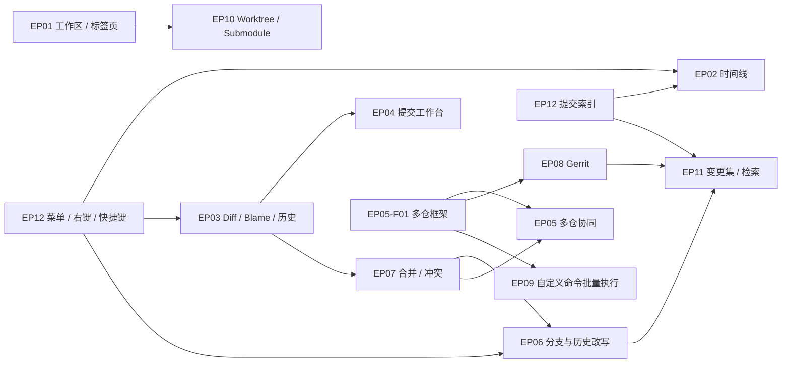

# GitSpace 功能缺口与规划（Epic 总览）

| 文档信息 | 说明 |
|---|---|
| 版本 | v1.0（2026-10-31） |
| 状态 | Draft，待评审 |
| 依据 | MRD（文件 v2.0，文档头 v1.5）；TechStack v1.0（含 v1.1 变更）；`docs/func/GitSpace-Features-v1.0.md`；`repos/GitSpace` 代码盘点（2026-10-31）；[Fork 与 IDEA 调研](./research-fork-idea.md) |
| 范围约定 | 本目录不修改 MRD。MRD 已承诺但未实现的标「P0 补齐」；MRD 之外的新增建议标「待评审」，回写建议见 §7 |

## 1. 结论

1. 现有 MVP 搭好了 P0 骨架，但 MRD 已承诺的能力中还有 32 项未兑现或做了简化，集中在：并排 diff、blame 与文件历史、多工作区与标签页、丢弃撤销、推送确认、外部合并工具、tag 推送、stash diff，以及索引性能、全键盘、VoiceOver、中英双语等非功能硬约束。
2. 与 Fork 的手感差距主要在交互底座：全应用只有 1 处右键菜单、2 个在菜单注册的快捷键，提交行、文件行、分支都没有右键入口。这一块投入小、影响面最大，排在最前。
3. 与 IDEA 的多仓差距是 GitSpace 的核心机会：同步分支操作、多仓 Push 对话框、跨仓提交、更新工作区、分支一致性提示。Fork 完全没有这些能力，IDEA 只在重型 IDE 里提供。
4. 扩展方向中，Gerrit `refs/for` 评审推送对锚点团队价值最高：Fork 需要用户自己写 Custom command，IDEA 的 Git 文档没有覆盖。
5. 全部 12 个 Epic、109 个 Feature，粗估 148.5 人周：批次 A（P0 兑现）41、批次 B（M4 第一批）72.5、批次 C（M4 第二批）35。

## 2. 口径

| 标签 | 含义 |
|---|---|
| P0 补齐 | MRD 10.1 / 10.2 / 10.4 / §12 已承诺，当前未实现或简化实现；不涉及范围变更，只需排期 |
| P1 / P2 | MRD 10.1、10.3 已列入对应阶段的能力 |
| P1 待评审 / P2 待评审 | MRD 未列入，本次基于 Fork / IDEA 对标新增的建议，需评审后才进入范围 |

- 批次：A = P0 兑现，并入 M1 至 M3 收尾；B = M4 第一批（P1 与高价值待评审项）；C = M4 第二批（P2 与低优先级待评审项）。里程碑名称沿用 MRD §13（M0 至 M4）。
- 人周：按 1 名熟悉本工程的研发估算，含单测与 git 等价性用例，不含评审等待与视觉走查；Agent 协作可以压缩，均需研发校准。
- 验收：每个 Epic 的验收口径都以 git 命令行结果为基准（MRD 10.4），并遵守安全边界（MRD 10.2-G：永不 force、破坏性操作二次确认、写操作全量记录）。

## 3. 现状基线（2026-10-31 代码盘点）

| 能力域 | 已有 | 缺失或简化 |
|---|---|---|
| 工作区 | 添加仓库、扫描父目录（深度 3）、粘贴 mgit 清单、JSON 持久化 | 单工作区；单窗口无标签页；没有 remote 与凭据入口 |
| 时间线 | 跨仓合并、仓库 / 分支 / 作者 / 时间 / 关键字过滤、提交详情、截断提示 | 每仓一个色点，没有 DAG；没有 ref 徽标；提交行没有右键；没有路径过滤 |
| diff | `DiffTextView` 渲染原始 unified 文本 | 没有并排、行号、词级与语法高亮；没有 blame 与文件历史 |
| 提交 | 文件级与块级暂存（与 `git add -p` 等价）、amend、钩子输出原样展示 | 丢弃只到文件级且不可撤销；没有信息历史与模板；没有提交并推送；没有行级暂存 |
| 同步 | 单仓与批量 fetch / pull（ff-only、merge）/ push，可取消与重试 | 没有预检汇总与推送确认；只能推已有上游的分支；没有 rebase 模式 |
| 分支与合并 | 分支增删改切、检出远程；merge ff / no-ff；冲突选边、生成标记、中止 | 合并信息不可编辑；没有外部合并工具；没有 rebase、cherry-pick、revert、reset、reflog |
| stash / tag | 保存、列表、pop / apply / drop；tag 创建与删除 | 看不到 stash 内容；tag 不能推送（引擎已有 `pushTag`，界面未接入） |
| 交互底座 | 命令面板 ⌘K、Toast、JSONL 操作日志、设置页 | 只注册 2 个快捷键、1 处右键菜单；没有 VoiceOver 标签；文案只有中文；没有自动刷新 |
| 性能与发布 | 内存聚合加时间窗截断 | 没有 SQLite / FTS5 索引；以 SPM 可执行 target 运行，未签名公证；匿名统计未实现 |

## 4. 差距矩阵

✓ 支持；部分 = 有但不完整；✗ 不支持。Fork 与 IDEA 两列的出处见[调研文档](./research-fork-idea.md)。

| 能力 | Fork | IDEA | GitSpace 现状 | 归属 |
|---|---|---|---|---|
| 多仓合并时间线 | ✗ | ✓ | ✓ | 已有 |
| 多工作区、多窗口、标签页 | ✓ | 不适用（按项目开窗） | ✗ | EP01-F01 / F02 |
| 新仓库发现、Remote 管理、凭据入口 | ✓ | ✓ | ✗ | EP01-F03 / F05 / F06 |
| 真实提交图与 ref 徽标 | ✓ | ✓ | 部分 | EP02-F01 / F02 |
| 提交右键菜单 | ✓ | ✓ | ✗ | EP02-F03、EP12-F02 |
| 路径过滤、跳转 hash、父子提交导航 | ✓ | ✓ | ✗ | EP02-F05 |
| 两提交对比、分支对比 | ✓ | ✓ | ✗ | EP02-F06、EP05-F09 |
| 并排 diff、行号、词级高亮 | ✓ | ✓ | ✗ | EP03-F01 / F02 |
| Blame、文件历史 | ✓ | ✓ | ✗ | EP03-F03 / F04 |
| 图片 diff | ✓ | ✓ | ✗ | EP03-F07 |
| 块级暂存 | ✓ | ✓ | ✓ | 已有 |
| 行级暂存 | ✓ | ✓ | ✗ | EP04-F05 |
| 丢弃单块、撤销丢弃 | ✓ | ✓ | 部分 | EP04-F01 |
| 提交信息历史与模板、提交并推送 | ✓ | ✓ | ✗ | EP04-F02 / F03 |

| 推送前确认（仓库与提交数） | ✓ | ✓ | ✗ | EP05-F02 |
| 分支一致性提示 | ✗ | ✓ | ✗ | EP05-F03 |
| 同步分支操作（多仓同名分支） | ✗ | ✓ | ✗ | EP05-F04 |
| 多仓 Push 对话框 | ✗ | ✓ | 部分（批量 push 无预览） | EP05-F05 |
| 跨仓一次提交 | ✗ | ✓ | ✗ | EP05-F06 |
| 更新工作区（Update Project） | 部分（单仓 lean branching） | ✓ | 部分（批量 pull） | EP05-F07 |
| 侧栏分支树、收藏、拖拽合并 | ✓ | ✓ | ✗（弹窗管理） | EP06-F01 / F02 |
| Rebase、cherry-pick、revert | ✓ | ✓ | ✗ | EP06-F04 / F05 / F07 |
| 撤销提交、reset、reflog | ✓ | ✓ | ✗ | EP06-F08 / F09 |
| 交互式 rebase | ✓ | ✓ | ✗ | EP06-F10 |
| 外部合并工具 | ✓ | ✓ | ✗ | EP07-F02 |
| 内置三方合并编辑器 | ✓ | ✓ | ✗ | EP07-F07 |
| Stash diff、部分 stash | ✓ | ✓ | ✗ | EP07-F04 / F09 |
| Tag 推送 | ✓ | ✓ | ✗ | EP07-F05 |
| Gerrit `refs/for` 评审推送 | 部分（需 Custom command） | ✗（文档未涉及） | ✗ | EP08 |
| 在终端、编辑器中打开 | ✓ | 不适用（IDE 内） | 部分（仅访达） | EP09-F01 |
| 自定义命令 | ✓ | 未涉及 | ✗ | EP09-F05 |
| Issue / 卡片号链接 | ✓ | ✓ | ✗ | EP09-F03 |
| Worktree、submodule、LFS、签名 | ✓ | ✓ | ✗ | EP10 |
| AI 生成提交信息 | ✓（2.59 起） | 未核实 | ✗ | EP04-F09 |
| 卡片号聚合、变更集 | ✗ | ✗ | 部分（超前占位） | EP11 |
| 命令面板 | ✓（⌘P） | ✓（⌃V） | ✓（⌘K，部分命令无快捷键） | EP12-F01 |
| 全键盘、VoiceOver、中英双语 | ✓ | ✓ | ✗ | EP12-F03 / F04 / F05 |
| 自动刷新、后台 fetch | ✓ | ✓ | ✗ | EP12-F10 |
| 操作记录查看 | ✓（Activity Manager） | 未核实 | 部分（只写日志） | EP12-F11 |

## 5. Epic 一览

| Epic | 目标 | Feature | 其中 P0 补齐 | A | B | C | 合计人周 |
|---|---|---|---|---|---|---|---|
| [EP01 多工作区与仓库管理](./EP01-workspace-repos.md) | 工作区、窗口、标签页、remote、凭据 | 9 | 3 | 4.5 | 2.5 | 3.5 | 10.5 |
| [EP02 统一时间线与提交详情](./EP02-timeline.md) | DAG 图、ref 徽标、右键、过滤导航、对比 | 11 | 4 | 4.5 | 4.5 | 2 | 11 |
| [EP03 Diff、Blame 与文件历史](./EP03-diff-blame-history.md) | 并排、词级高亮、blame、历史、图片 diff | 10 | 4 | 7 | 6 | 2.5 | 15.5 |
| [EP04 提交工作台](./EP04-commit-workbench.md) | 丢弃撤销、信息辅助、提交并推送、行级暂存 | 10 | 3 | 3.5 | 5 | 4 | 12.5 |
| [EP05 多仓协同操作](./EP05-multi-repo-ops.md) | 推送确认、分支一致性、同步分支、跨仓提交、更新工作区 | 11 | 3 | 3 | 14 | 1 | 18 |
| [EP06 分支管理与历史改写](./EP06-branch-history.md) | 分支树、rebase、cherry-pick、revert、reset、reflog、交互式 rebase | 12 | 0 | 0 | 14.5 | 6 | 20.5 |
| [EP07 合并、冲突、Stash 与 Tag](./EP07-merge-conflict-stash-tag.md) | 外部合并工具、三方合并编辑器、stash 与 tag 补齐 | 11 | 5 | 4 | 8 | 1.5 | 13.5 |
| [EP08 Gerrit 评审工作流](./EP08-gerrit-review.md) | `refs/for` 推送、跨仓 topic、Change-Id 守护 | 7 | 0 | 0 | 6.5 | 2 | 8.5 |
| [EP09 外部集成与自定义命令](./EP09-integrations-commands.md) | Open in、卡片号链接、自定义命令、AI 代理设置 | 6 | 1 | 1 | 5 | 1 | 7 |
| [EP10 高级仓库能力](./EP10-advanced-repo.md) | worktree、submodule、LFS、git-flow、签名 | 6 | 0 | 0 | 0 | 8.5 | 8.5 |
| [EP11 变更集与聚合检索转正](./EP11-changeset-search.md) | 分字段检索、交付清单、变更集完整性 | 4 | 0 | 0 | 2 | 3 | 5 |
| [EP12 体验基建](./EP12-ux-foundation.md) | 菜单快捷键、右键、键盘、VoiceOver、双语、索引、自动刷新、发布 | 12 | 9 | 13.5 | 4.5 | 0 | 18 |
| 合计 | | 109 | 32 | 41 | 72.5 | 35 | 148.5 |

## 6. 路线图

### 6.1 批次 A：P0 兑现（41 人周，并入 M1 至 M3 收尾）

| 顺序 | 内容 | Feature | 人周 |
|---|---|---|---|
| A1 交互底座 | 菜单与快捷键、右键体系、键盘导航；ref 徽标、提交右键、详情补全；在终端 / 编辑器打开 | EP12-F01 至 F03，EP02-F02 至 F04，EP09-F01 | 6 |
| A2 看与改 | 并排 diff、词级高亮、blame、文件历史；DAG 提交图；丢弃撤销、信息辅助、提交并推送；合并收尾、外部合并工具、两者都保留、stash diff、tag 推送；多仓框架、推送确认、分支一致性；多工作区、标签页、凭据 | EP03-F01 至 F04，EP02-F01，EP04-F01 至 F03，EP07-F01 至 F05，EP05-F01 至 F03，EP01-F01 至 F03 | 24.5 |
| A3 非功能 | VoiceOver、中英双语、提交索引、匿名统计、发布基础、设置扩展 | EP12-F04 至 F09 | 10.5 |

A1 先做：后续每个 Epic 的入口都挂在菜单、右键与快捷键上。A3 中的提交索引（4 人周）是 MRD 10.4-2 性能验收的前提，建议与 A2 并行。

### 6.2 批次 B：M4 第一批（72.5 人周）

- B1 首批（29.5 人周，建议优先评审）：
  - 多仓协同：EP05-F04 同步分支、F05 多仓 Push 对话框、F06 跨仓提交、F07 更新工作区（10）
  - Gerrit：EP08-F01 至 F04（5）
  - 历史操作：EP06-F04 rebase、F05 cherry-pick、F07 revert（5）
  - 冲突：EP07-F07 内置三方合并编辑器（4）
  - 其他：EP12-F10 自动刷新（2）、EP04-F05 行级暂存（2.5）、EP09-F03 卡片号链接（1）
- B2（43 人周）：批次 B 的其余 Feature，按各 Epic 表格中的顺序推进。

### 6.3 批次 C：M4 第二批（35 人周）

交互式 rebase 与历史快捷改写、bisect、变更分组、AI 提交信息、worktree / submodule / LFS / git-flow / 签名、选区历史、任意版本文件树、补丁、统计、Gerrit 评审状态只读展示等。

### 6.4 时间折算

按 2 名研发并行粗算：批次 A 约 20 周，B1 约 15 周，B2 约 22 周，C 约 18 周。MRD §13 的 M1 至 M3 估算（2 人 4 至 5.5 个月）没有单列非功能基建，批次 A 中这部分约 10.5 人周，建议据此重估 MRD 17.2-8 的人力配置。

### 6.5 Epic 依赖

## 7. MRD 回写建议（待评审）

本目录不修改 MRD。以下建议评审通过后，按 AGENTS.md §3 回写 MRD 并记入其 §16 变更记录。

1. §10.1 能力基线新增行：同步分支操作、多仓 Push 对话框、跨仓提交、更新工作区、跨仓 tag 与分支对比、Gerrit 评审推送、自定义命令、reflog、AI 提交信息，并标注阶段。
2. §10.2-B push 口径补充两条：新分支首推时设置 upstream；Gerrit 评审模式的仓推送到 `refs/for/<目标分支>`。
3. §10.3 增补：P1 加入 EP05-F04 至 F10 与 EP08-F01 至 F06；P2 加入变更分组（EP04-F10）与 AI 提交信息（EP04-F09）。
4. §10.5 边界澄清：推送到 `refs/for` 属于 git 推送，不属于「PR / MR 创建」；通过 Gerrit REST 读取评审状态（EP08-F07）是否允许，需要明确。
5. §11 场景二的「分支不一致」已有表述，建议在 §10.2-A 增加「分支一致性提示」作为 P0 条目，与 EP05-F03 对应。
6. §12 快捷键：恢复关闭标签使用 ⇧⌘T，现有「Tag 管理」改为 ⇧⌘G；命令面板保持 ⌘K 并以 ⌘P 为别名。
7. §13 里程碑与人力：按批次 A 41 人周重估 M1 至 M3，单列非功能基建。
8. §17.2 新增待定项：`reset --hard` 是否开放；自定义命令的安全口径；后台 fetch 默认值；AI 的数据外发口径；丢弃撤销快照的保留时长。

## 8. 待评审决策点

| # | 议题 | 建议 | 涉及 |
|---|---|---|---|
| 1 | 批次 B 是否先做 B1（多仓协同、Gerrit、rebase / cherry-pick / revert、合并编辑器） | 先做 B1：这是与 Fork 拉开差距、并让锚点团队离开命令行的部分 | §6.2 |
| 2 | 内置三方合并编辑器进入 B1（MRD 17.2-9） | 进入 B1：跨仓 cherry-pick 与更新工作区会让冲突更频繁，只靠外部工具体验断裂 | EP07-F07 |
| 3 | 时间线完整 DAG 的仓库数阈值 | 默认 3 个仓以内画完整图，其余用紧凑模式 | EP02-F01 |
| 4 | 凭据写入方式：git credential 还是 Security framework | git credential：与命令行共用一份凭据，符合「CLI 为唯一执行来源」 | EP01-F03、TechStack §8 |
| 5 | `reset --hard` 是否开放 | 不开放；丢弃改动已有逐文件路径与快照撤销 | EP06-F08 |
| 6 | Gerrit 评审状态只读展示（REST API） | 暂不做，先完成 git 原生推送闭环 | EP08-F07、MRD 10.5 |
| 7 | AI 提交信息 | 默认关闭，只调用用户配置的本机 CLI，不内置云端服务 | EP04-F09、EP09-F06 |
| 8 | 快捷键 ⇧⌘T 调整为恢复关闭的标签 | 调整，Tag 管理改为 ⇧⌘G | EP12-F01 |
| 9 | 变更集、聚合检索的一级入口（Story-1030 待评审项） | 变更集保留一级 tab；聚合检索并入时间线过滤与命令面板 | EP11 |
| 10 | 后台定时 fetch 默认值 | 默认关闭，开启后间隔可设 | EP12-F10 |
| 11 | 改写已推送历史 | 普通仓禁止；Gerrit 评审仓允许改写未合入的提交并推新补丁集 | EP06 §6、EP08 §6 |

## 9. 文档导航

- 调研事实：[research-fork-idea.md](./research-fork-idea.md)
- 各 Epic：见 §5 表格中的链接，每份文档结构一致：现状、对标参考、Feature 清单、交互规格（含线框、状态表、快捷键）、验收口径、风险与明确不做。
- 进入开发时：从 Epic 中选定 Feature，按 AGENTS.md §3 拆为 `specs/[Story-MMDD]-<slug>/`，doc.md 引用对应的 Feature ID。
- 上游文档：MRD `docs/prd/GitSpace-MRD-v2.0.md`；TechStack `docs/feature/GitSpace-TechStack-v1.0.md`；当前功能 `docs/func/GitSpace-Features-v1.0.md`。
