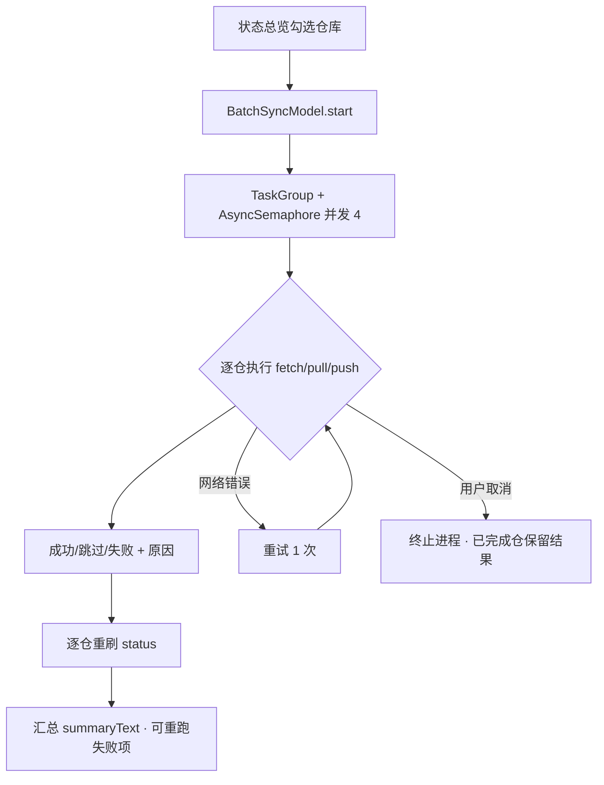
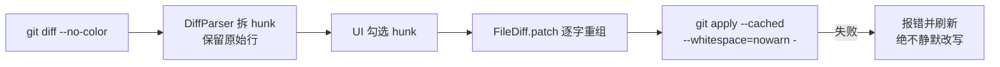

# GitSpace MVP（v0.1.0）设计文档

| 属性 | 内容 |
| --- | --- |
| 文档状态 | 已确认（实现已完成并验证；本文件为**回溯归档**的方案事实源，实现记录见 [Story-1029-mvp-coding](../Story-1029-mvp-coding/)） |
| 目标版本 | v0.1.0-mvp（MRD 里程碑 M1「骨架与同步」+ M2「日常闭环」核心子集） |
| 文档用途 | MVP 方案的唯一事实源，任务拆解见同目录 `tasks.md` |

## 背景和目标

GitSpace 是面向多仓库工程的 macOS 原生 Git 客户端（定位见 MRD v1.5，文件 v2.0：路线一「替代型」）。文档与交互原型已产出但零代码，本需求要求把「日常上班不出这个窗口」的 P0 闭环做出第一版可运行实现，交互对齐 `design/gitspace-prototype/index-origin.html`。

**目标（可判定）**：

1. `swift build` 零错误产出 `GitSpaceApp` 可执行文件，可直接启动为 GUI 应用。
2. 实现纳管 / 跨仓时间线 / 多仓状态 / 批量同步 / 提交（含块级暂存）/ 分支 / 合并冲突 / stash / tag 九大能力域，安全边界满足 MRD 10.2-G。
3. MRD 10.4 十三条验收标准中 3、4、9、10、11、12、13 条自动化（以 git CLI 输出为基准的等价性测试）全部通过。
4. 工程结构按 TechStack §9 落地，依赖方向单向，`GSGitEngine`/`GSIndex` 不 import SwiftUI。

## 当前代码库现状

**动工时（2026-10-29 之前）**：Workspace 处于方案阶段——MRD v1.5、TechStack v1.0、交互原型 `index-origin.html` 已产出；`repos/` 仅有落地约定 README，Swift 工程未初始化；工具链实测 Xcode 27.1 / Swift 6.4 / macOS 27.2 / git 2.54，满足 TechStack §3 全部前提。

**实现后**：`repos/GitSpace/` 为 SPM 多模块工程（36 个 Swift 文件，约 6000 行），零第三方依赖，构建 / 26 测试 / 冒烟（RSS ≈ 136MB）全部通过。

## 架构和技术设计

模块结构按 TechStack §9，依赖方向单向：

```mermaid
flowchart LR
    APP[GitSpaceApp\n@main · 三栏骨架 · 四视图] --> F[GSFeatures\nAppModel · TimelineModel\nRepoViewModel · BatchSyncModel]
    F --> E[GSGitEngine\n进程执行器 · 解析器\n单仓 actor 门面]
    F --> I[GSIndex\n扫描器 · 配置存储\n时间线聚合]
    F --> D[GSDesignKit\n设计令牌 · 色板]
    E --> INF[GSInfra\n路径 · JSONL 操作日志\nAsyncSemaphore]
    E -. 唯一数据源 .-> GIT[(系统 git CLI)]
    I --> E
```

git 引擎按 TechStack §5：**系统 git CLI 是唯一执行与数据来源**，不自算状态、不引 libgit2。进程层为 actor 模型——每仓一个 `GitRepository` actor（同仓串行、跨仓天然并行），全局 `GitProcessRunner` 统一超时（60s → SIGTERM）、取消（终止进程）、重试（仅网络类错误 1 次）与**参数级安全闸**。

## 数据流或调用链

链路一：批量同步（MRD 10.6 流程四）



链路二：块级暂存（TechStack §5.3，MRD 10.4-10 的实现保障）



## 关键接口与数据结构

```swift
// 进程层（GSInfra 之上，GSFeatures 之下）
actor GitProcessRunner {
    func run(directory: URL, arguments: [String], options: GitExecutionOptions) async throws -> GitOutput
    static func validate(_ arguments: [String]) throws   // 安全闸：拦截 force/reset --hard/clean/-f
}
struct GitExecutionOptions { var timeoutSeconds: Int; var stdin: Data?; var retriesOnNetworkError: Int }

// 单仓门面（actor，同仓串行）
actor GitRepository {
    func status() async throws -> RepoStatus             // porcelain=v2 -z 解析
    func commits(limit: Int, since: Date?) async throws -> [CommitInfo]
    func worktreeDiff() / stagedDiff() -> [FileDiff]
    func stageHunks(of: FileDiff, hunkIDs: Set<Int>) async throws
    func merge(ref: String, style: MergeStyle) async throws -> MergeOutcome
}

// 跨仓聚合（GSIndex）
enum TimelineAggregator { static func build(repos: [(name: String, path: String, commits: [CommitInfo])]) -> [TimelineCommit] }

// UI 状态层（GSFeatures，@MainActor @Observable）
@Observable final class AppModel  { var repos: [ManagedRepo]; func refreshAll() async; ... }
@Observable final class BatchSyncModel { func start(action: BatchAction, repos: [ManagedRepo]); func retryFailed() }
@Observable final class RepoViewModel { func stageHunks(of:hunkIDs:) async throws; func merge(ref:) async throws -> MergeOutcome }
```

## 错误处理、兼容性和边界情况

- **错误分类**：`GitError` 按取消 / 超时 / 鉴权 / 网络 / 冲突 / 非快进 / 脏工作区 / 钩子失败 / 无上游 / 安全闸归类，仅网络与超时可重试；钩子失败原始输出完整透出，不吞错。
- **进程边界**：`GIT_TERMINAL_PROMPT=0` 防鉴权挂起；stdout/stderr 管道与进程并行读，防 64KB 管道死锁；`OnceBox` 保证 continuation 恰好恢复一次（terminationHandler / 超时 / 取消三方竞争）。
- **单仓失败不阻塞**：状态刷新与时间线加载按仓隔离，单仓异常仅标记该仓 `errorText`，其余仓正常（MRD 10.4-7）。
- **崩溃恢复**：启动/刷新时检测 `MERGE_HEAD`（rev-parse verify）呈现「合并进行中」并可中止（MRD 10.2-G 状态可解释）。
- **安全边界（引擎硬闸）**：代码中不存在 force push / `reset --hard` / `clean` 调用路径，`validate()` 在参数层拦截；丢弃改动走 `git restore` 逐文件路径 + UI 二次确认。
- **兼容**：部署目标 macOS 14（采纳 TechStack §3 建议值，MRD 12 的 13 待评审）；Swift 6 语言模式严格并发。

## 测试策略

Swift Testing 框架，全部命令行可跑：`cd repos/GitSpace && swift test`。等价性基准统一是 git CLI 本身：fixture 仓生成器（`GSTestSupport/FixtureRepo`：多 hunk / 冲突 / 钩子场景）造仓 → 引擎操作 → 与 `GitShell.run` 的原始 git 输出逐项比对。通过口径：26/26 用例通过（覆盖 MRD 10.4-3/4/9/10/11/12/13）；运行时冒烟：`.build/debug/GitSpaceApp` 启动存活、无崩溃。

## 工作项拆分

| 编号 | 端 | 标题 | 内容描述 | 关注文件与目录 | 依赖 |
| --- | --- | --- | --- | --- | --- |
| W1 | 工程 | 工程骨架与严格并发基线 | Package.swift 定义 7 target + 2 测试 target，目录按 TechStack §9，Swift 6 语言模式、部署目标 macOS 14 | `repos/GitSpace/Package.swift` | 无 |
| W2 | 客户端(macOS) | GSInfra 基础设施 | 应用路径约定、JSONL 按日滚动操作日志、TaskGroup 限流信号量 | `Packages/GSInfra/Sources/GSInfra/` | W1 |
| W3 | 客户端(macOS) | Git 进程执行器与安全闸 | actor 执行器（超时/取消/重试/管道并行读）、错误分类、参数级安全闸 | `Packages/GSGitEngine/Sources/GSGitEngine/GitProcessRunner.swift`、`GitError.swift` | W1, W2 |
| W4 | 客户端(macOS) | git 输出解析器套件 | porcelain v2 / log 自定义分隔符 / for-each-ref / unified diff 四组解析器与值模型 | `Packages/GSGitEngine/Sources/GSGitEngine/Parsers.swift`、`DiffParser.swift`、`Models.swift` | W1 |
| W5 | 客户端(macOS) | 单仓引擎门面与写操作 | 只读快照 + 暂存（文件/块）/ 提交 / 分支 / 合并冲突 / stash / tag，写操作统一留痕 | `Packages/GSGitEngine/Sources/GSGitEngine/GitRepository.swift`、`GitRepository+Write.swift` | W3, W4 |
| W6 | 客户端(macOS) | 工作区扫描与配置存储 | 父目录递归发现（跳过构建产物）、工作区 JSON 持久化 | `Packages/GSIndex/Sources/GSIndex/WorkspaceScanner.swift`、`WorkspaceStore.swift` | W1, W4 |
| W7 | 客户端(macOS) | 跨仓时间线聚合 | 多仓提交合并为按时间排序的单条时间线（每仓一 lane） | `Packages/GSIndex/Sources/GSIndex/Timeline.swift` | W4 |
| W8 | 客户端(macOS) | ViewModel 状态层 | 工作区纳管/状态刷新、批量同步状态机、时间线过滤与详情、当前仓全量操作 | `Packages/GSFeatures/Sources/GSFeatures/`（3 个 Model 文件） | W5, W6, W7 |
| W9 | 客户端(macOS) | App 骨架与全局组件 | @main、三栏 NavigationSplitView、侧栏仓库列表、toast、状态栏、设置页、主题三态 | `App/Sources/GitSpaceApp/GitSpaceApp.swift`、`RootView.swift`、`SidebarView.swift`、`Components.swift`、`SettingsView.swift` | W8 |
| W10 | 客户端(macOS) | 时间线视图与 diff 渲染 | 过滤栏、提交列表（图列）、详情面板、AppKit NSTextView diff 渲染 | `App/Sources/GitSpaceApp/TimelineView.swift`、`DiffTextView.swift` | W9 |
| W11 | 客户端(macOS) | 状态总览与批量面板 | 统计卡、逐仓表格、批量操作条、批量执行 Sheet、添加/扫描弹窗 | `App/Sources/GitSpaceApp/StatusView.swift`、`Sheets.swift` | W9 |
| W12 | 客户端(macOS) | 改动提交与分支合并视图 | 未暂存/已暂存两栏 + hunk 勾选、提交栏；分支/冲突/stash/tag 管理页 | `App/Sources/GitSpaceApp/WorkingView.swift`、`RepoView.swift` | W9 |
| W13 | 工程 | 测试基建与等价性用例 | GitShell 基准封装、fixture 仓生成器，4 个测试文件 26 条用例 | `Packages/GSTestSupport/`、`Tests/` | W5, W6, W7 |
| W14 | 文档 | 文档与索引同步 | 本 spec、实施记录、source 三件套、INDEX/repo-structure 同步 | `specs/`、`source/`、`INDEX.md`、`docs/repo-structure.md` | W1–W13 |

拆分判断说明：W3/W4 拆开是因为进程执行与输出解析职责独立、可分别测试；W5 合并读写是因为同仓 actor 门面天然一体；UI 按 Swift 文件边界拆四块，各自可独立编译验收。

## 明确不做（本版范围外，MRD 10.3 原样后移）

- 变更集视图 / 卡片号聚合检索（P1 视图，原型有演示页但属 P1 范围）
- 行级暂存、cherry-pick / revert、rebase、图片 diff、并排 diff、语法高亮
- GRDB + FTS5 提交索引（50 仓 × 10 万提交性能口径，M0 验证后引入）
- 正式 .xcodeproj / 签名 / 公证 / DMG / Sparkle 分发链路
- 匿名统计上报、PR/MR、Windows/Linux

技术偏离项（GRDB 暂缓、SPM 可执行 target、GSFeatures 合一 target、每仓一 lane、diff 仅统一视图）的完整清单与理由见 [Story-1029-mvp-coding/doc.md §4](../Story-1029-mvp-coding/doc.md)，待随 M0 技术评审一并裁决。
