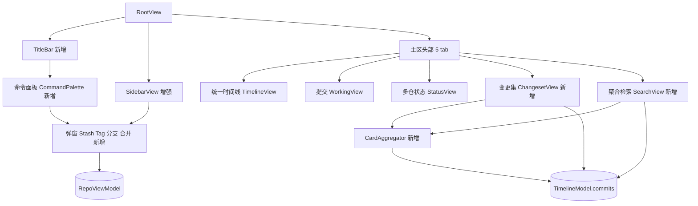
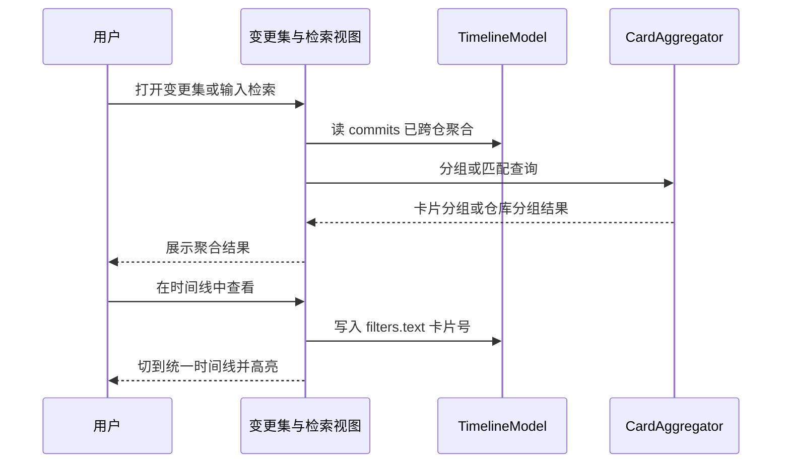
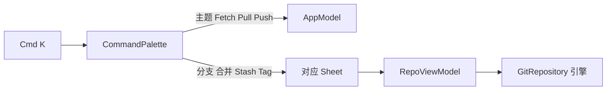

# Story-1030 GitSpace App 界面与交互对齐原型 · 设计文档

状态：Draft（待用户 review）。所属工程：`repos/GitSpace`（macOS SwiftUI）。本次只改 App 层 Swift 代码与 GSFeatures / GSIndex 逻辑，不改 `design/gitspace-prototype/` 原型文件。

## 1. 背景与目标

交互原型 `design/gitspace-prototype/index.html` 已给出完整界面与交互形态。当前 App 跑起来（图四）与原型的三个区域在「有哪些模块」和「视觉样式」上有差距，且原型的命令面板（图五）在 App 中完全缺失：

- 图一 顶部标题栏：App 没有这条独立栏（只有系统窗口栏 + 主区 tab 栏）
- 图二 左侧栏：App 有 `SidebarView`，但工作区卡片与底部操作区不全
- 图三 主区头部：App 是 4 个 tab，原型是 5 个
- 图五 命令面板：App 完全没有

目标：让 App 这三个区域对齐原型，补齐缺失模块与视觉，并新增命令面板（⌘K）及其唤起的弹窗。验收以「原型交互一致 + MRD §10.4 十三条 P0 口径不走样」为准。

## 2. 范围与边界

本次做：

- 顶部标题栏 `TitleBar`：品牌、工作区切换 pill、快速操作 ⌘K、主题切换、设置入口
- 左侧栏增强：工作区卡片补副标题 / 数据新鲜度 / 加载进度条，底部补「导入 mgit 清单」「Stash」「Tag」入口
- 主区 tab 由 4 个重构为原型 5 个：统一时间线 / 提交 / 多仓状态 / 变更集 / 聚合检索
- 新增「变更集」「聚合检索」两个视图
- 新增命令面板，以及 Stash / Tag / 分支 / 合并 四个独立弹窗
- 移除现有「分支·合并」独立主 tab，其分支 / 合并 / Stash / Tag 能力迁入命令面板与侧栏唤起的弹窗

本次不做：

- 不改原型 HTML，不改底层 git 引擎能力（分支 / 合并 / stash / tag 引擎已具备）
- 不做真正的多工作区管理（新建 / 切换 / 持久化多个工作区）；工作区 pill 只做展示与下拉外壳，底层仍单工作区
- 不新增 git 能力，弹窗与视图只复用 `RepoViewModel` / `TimelineModel` 现有能力
- 变更集只做「按卡片号跨仓聚合 + 跳转时间线 + 复制清单」；聚合检索只做「卡片号 / 信息 / 作者跨仓检索 + 按仓库分组 + 生成 CR 清单」，不做 P2 的交互式 rebase 等

### 2.1 对 MRD / TechStack 的影响（据 docs 调研）

- 命令面板、顶部标题栏、变更集视图、聚合检索视图、主题切换控件在 MRD / TechStack 中均无对应条目，属新增界面信息架构。
- 变更集为 P1/P2，聚合检索为 P1（MRD §10.1 L250 / §10.3 L308, L313）。把它们做成 P0 界面一级 tab 属「超前占位」，在文档与 UI 上标注「待评审」。
- 移除「分支·合并」独立 tab 改为弹窗访问：不与 §17.1 已决策冲突（§17.1 未涉及视图结构），P0 功能与 §10.4 验收均不变，不触发「必须回写 MRD」；但需回写 TechStack §4.3 界面映射表并提请评审。
- 红线：UI 怎么改，MRD §10.4 的 13 条 P0 验收口径一条都不能丢（尤其分支 §10.4-11 / 合并 §10.4-12 / 合并后 push §10.4-13）。

## 3. 当前代码库现状

| 区域 | 现状文件 | 现状 |
|---|---|---|
| 入口 / 主题 | `GitSpaceApp.swift` | WindowGroup + Settings；主题 `@AppStorage("appearance")` 驱动 `.preferredColorScheme` |
| 根骨架 | `RootView.swift` | NavigationSplitView；detail = headerBar（4 tab + 刷新 + 全部 Fetch）+ content + StatusBarView |
| 侧栏 | `SidebarView.swift` | workspaceCard + 搜索 + 仓库列表 + footer（仅 添加 / 扫描） |
| 分支合并等 | `RepoView.swift` | 「分支·合并」tab：合并 / 分支 / stash / tag 四段 Section，针对选中仓库 |
| 状态 | `AppModel.swift` | 单工作区、repos、batch、toasts、gitVersionText |
| 仓操作 | `RepoViewModel.swift` | 已具备 branch / merge / stash / tag 全部能力 |
| 时间线 | `TimelineModel.swift` | 持有跨仓聚合 commits + Filters（仓库 / 分支 / 作者 / 关键字 / 时间） |

## 4. 总体架构与模块落位

新增视图与弹窗放 App 层；卡片号提取与聚合这类纯逻辑放 GSIndex（不得 import SwiftUI）。依赖方向不变：`App → GSFeatures → (GSGitEngine, GSIndex, GSDesignKit) → GSInfra`。



落位约定：

- App 层新增 `TitleBar.swift`、`CommandPalette.swift`、`ChangesetView.swift`、`SearchView.swift`，弹窗追加到现有 `Sheets.swift`（`BranchSheet` / `MergeSheet` / `StashSheet` / `TagSheet`）
- GSIndex 新增 `CardAggregator.swift`：从 `CommitInfo.subject/body` 正则提取卡片号并跨仓分组，供变更集与聚合检索共用
- 命令面板状态挂在 `AppModel`（全局唤起），避免散落在各视图

## 5. 分区设计

### 5.1 顶部标题栏 TitleBar（图1，新增）

在 `RootView.body` 最外层包 `VStack(spacing: 0) { TitleBar(...); NavigationSplitView{...} }`，使 TitleBar 横跨顶部左右两栏。macOS 红绿灯用系统原生，不自画 window-dots；原型的「交互视觉稿」小字不搬（属原型自标注）。

组成（从左到右）：

- 品牌：logo 图标 + `GitSpace`
- 工作区切换 pill：绿点 + 当前工作区名 + `N 个仓库` + 下拉箭头；点击展开 `Menu` 列出已配置工作区并高亮当前项。数据取 `app.workspace?.name`、`app.repoCount`。本次单工作区，菜单仅当前项，故仅一项时下拉箭头置灰禁用，不弹空菜单
- `Spacer`
- 快速操作 chip：图标 + `快速操作 ⌘K`，点击打开命令面板
- 主题切换按钮：点击在 system / light / dark 间循环切换 `@AppStorage("appearance")`，快捷键 ⌘⇧L
- 设置按钮：齿轮图标，`openSettings`（复用现有 Settings 场景）

视觉令牌：横条高约 44，背景 `windowBackgroundColor`，底部 1px `Color.gs(.panelBorder)`；pill 与 chip 用 `Color.primary.opacity(0.05~0.08)` 圆角 7，间距走 `GSSpacing`。

### 5.2 左侧栏增强 Sidebar（图2）

`workspaceCard` 在现有「名称 + MULTI-REPO + N 个仓库 + git X.x」基础上补：

- 副标题：仓库构成摘要（如「app + components」），由仓库名归纳
- 数据新鲜度：「数据截至 X 分钟前」，取 `app.lastRefreshed` 相对时间
- 加载进度条：刷新时显示细进度条（`app.isRefreshing` 驱动），对齐原型 ws-progress

`footer` 在「添加仓库 ⌘O / 扫描父目录 ⌘⇧O」后补：

- 导入 mgit 清单：打开导入弹窗（解析 mgit 清单文件批量纳管，MVP 先解析仓库路径列表）
- 分隔线
- Stash 暂存 ⌘⇧S：打开 `StashSheet`
- Tag 管理 ⌘⇧T：打开 `TagSheet`

### 5.3 主区 tab 重构为 5 个（图3）

`RootView.MainTab` 由 timeline / status / working / repo 调整为原型 5 个，顺序与文案照原型：

| tab 文案 | data-view | 映射视图 | 计数徽标来源 |
|---|---|---|---|
| 统一时间线 | timeline | TimelineView | `timeline.filtered.count` |
| 提交 | commit | WorkingView | 选中仓 staged + unstaged + untracked 数 |
| 多仓状态 | status | StatusView | `app.attentionCount` |
| 变更集 | changeset | ChangesetView（新增） | 聚合出的卡片数 |
| 聚合检索 | search | SearchView（新增） | 无 |

- 移除 `.repo`（分支·合并）tab，其能力迁入命令面板 + 弹窗（见 5.7）
- 每个 tab 右侧加数字徽标，复用现有 headerBar 的 capsule 样式
- 「提交」「变更集」在未选中仓库或无数据时用 `EmptyStateView`
- `MergeBanner` 跨仓化：用 `app.anyMergeInProgress` 判定常驻（不再绑定单个 tab）。文案显示「N 个仓库合并进行中」，点「去解决」跳转首个合并中仓（设 `selectedRepoPath = app.mergingRepoID` 并切到「提交」tab），由该仓 `RepoViewModel` 就地解决或中止；banner 不对非选中仓就地中止，避免张冠李戴（守 §10.4-12）

### 5.4 变更集视图 ChangesetView（P1/P2 超前占位，待评审）

布局套 TimelineView 的 `VStack{ 过滤条 + HSplitView{ 列表 + 详情 } }`。数据由 `CardAggregator.group(timelineModel.commits)` 得到，结果缓存在 `ChangesetModel`（见 5.8），仅当 `timelineModel.commits` 变化时重算，不在 body 里即时分组：

- 列表：每行一个卡片号（示例以 MRD §17.4 的 `TASK-123456` 为准，真实数据形如 `tieba02-88421`），显示涉及仓库色点、「涉及 N 仓」、提交数、作者数、最新时间
- 缺口提示降级：不做「缺 N 仓」绝对基准（基准不可靠且易误导），列入待评审；MVP 只展示「涉及 N 仓」
- 截断提示：`timelineModel.commits` 已受 90 天窗口 + 每仓 800 条截断，复用 `timelineModel.truncatedRepos` 在顶部提示「已按时间窗口截断 N 仓，聚合可能不全」
- 详情：该卡片号下各仓提交（复用提权后的共享 `CommitRow`），底部「复制交付清单」「在时间线中查看」（回填 `timeline.filters.text` 为卡片号并切到时间线）

### 5.5 聚合检索视图 SearchView（P1 超前占位，待评审）

顶部搜索条 + 结果按仓库分组 + 生成 CR 清单：

- MVP 用统一关键字匹配，复用 `TimelineModel.Filters.matches` 的 haystack（subject + body + author + sha + repoName），对 `timelineModel.commits` 子串命中
- 分字段检索（仅作者 / 仅卡片号精确筛）列入待评审，MVP 不做（现有 `Filters` 不区分字段）
- 结果按仓库分组，组内复用共享 `CommitRow`
- 「生成 CR 清单」把命中提交整理为可复制文本（仓库 + 分支 + hash + 标题）

### 5.6 命令面板 CommandPalette（图5，新增；MRD 无此概念，本设计定义其口径）

交互对齐原型：⌘K 或点击标题栏快速操作 chip 唤起 overlay 弹窗，输入框过滤 + 命令列表 + 底部提示「↑↓ 选择，↵ 执行，Esc 关闭」。

- 状态：`AppModel.isPaletteOpen` / `paletteQuery`；⌘K 唤起在 App 的 `.commands`（`CommandGroup`）常驻注册 `app.isPaletteOpen = true`，不挂在面板内（面板关闭时其内部快捷键不在视图树、无法触发）
- 快捷键单点注册：表中快捷键只在 `.commands` 菜单注册一份，命令项与侧栏按钮仅展示文本不重复绑定；侧栏搜索占位符原写「⌘K」改为「筛选仓库或分支」，把 ⌘K 让给命令面板
- 键盘：上 / 下移动高亮，回车执行，Esc 关闭，输入实时按 label 子串过滤
- 命令项（对齐图5）：

| 命令 | 快捷键 | 执行 |
|---|---|---|
| 切换深浅色主题 | ⌘⇧L | 循环 appearance |
| 全部仓库 Fetch | ⌘⇧F | `runBatch(.fetch, repos: app.repos)` |
| 批量 Pull（选中待同步仓库） |  | 设 `app.selectedRepos` 为 ahead/behind 仓，切多仓状态，`runBatch(.pull, repos:)` |
| 批量 Push（选中未推送仓库） |  | 设 `app.selectedRepos` 为 ahead 仓，切多仓状态，`runBatch(.push, repos:)` |
| 新建 / 管理分支 | ⌘⇧B | 打开 BranchSheet |
| 合并分支 | ⌘⇧M | 打开 MergeSheet |
| 打开 Stash | ⌘⇧S | 打开 StashSheet |
| 打开 Tag 管理 | ⌘⇧T | 打开 TagSheet |
| 添加仓库 | ⌘O | 打开 AddRepoSheet |
| 扫描父目录 | ⌘⇧O | 打开 ScanSheetView |

无障碍：弹窗 `role=dialog`、输入框自动聚焦、全键盘可达（TechStack §2 L43）。

### 5.7 Stash / Tag / 分支 / 合并 独立弹窗（新增）

用户选定为这四类做独立弹窗（贴合原型图5交互）。随 `.repo` tab 移除，`RepoView` 退场，其四段 Section 重构为 4 个独立 `struct ...Sheet: View`，各自持有原 `@State`（newBranchName / stashMessage 等）与原 `confirmationDialog`，复用同一 `RepoViewModel`，不重写引擎调用：

- BranchSheet：本地 / 远程分支列表，新建并切换，切换 / 重命名 / 删除，检出远程。切换遇脏工作区时复用已就绪的 `vm.stashThenSwitchBranch`，弹「stash 后切换 / 取消」二选一，落实 §10.4-11 的「引导 stash」而非仅提示
- MergeSheet：选来源分支 + no-ff 开关 + 合并，冲突进入现有冲突解决流（守 §10.4-12/13）
- StashSheet：保存（带 message）/ 列表 / Pop / Apply / Drop（Drop 二次确认）
- TagSheet：创建（轻量 / 附注）/ 列表 / 删除
- 弹窗作用于 `app.selectedRepo`；未选中仓库时命令项用 toast 提示先在侧栏选仓库
- 破坏性操作（删分支 / Drop stash / 删 tag / 中止合并）全部二次确认（TechStack §2 L38）

### 5.8 现有文件改造清单（拆卡用）

- RootView：body 外层包 VStack（TitleBar + NavigationSplitView）；MainTab 改 5 项并改 content switch（删 .repo、加 .changeset / .search）；改 `@Bindable var app`；`.sheet(item:)` 挂最外层；`runBatch` 改走 `activeSheet`
- SidebarView：workspaceCard 补三项；footer 补「导入 mgit / Stash / Tag」；搜索占位符去掉 ⌘K；`showAddRepo / showScan` 绑定改走 `app.activeSheet`
- StatusView：选中集 `selectedRepos` 上移 AppModel（StatusView 读写 `app.selectedRepos`），使命令面板可外部预选
- TimelineView：`CommitRow` 提权为共享组件（移 Components.swift）
- RepoView：随 .repo tab 退场，四段 Section 迁为 4 个 Sheet
- GitSpaceApp：新增 `.commands` 注册 ⌘K 及各快捷键一份
- AppModel：新增 §7.2 字段与 `AppSheet`

## 6. 数据流与调用链

卡片号聚合数据流（变更集与聚合检索共用）：



命令面板触发链路：



## 7. 关键接口与数据结构

### 7.1 CardAggregator（GSIndex，纯函数，不 import SwiftUI）

```swift
public struct CardGroup: Identifiable, Sendable {
    public var id: String { card }
    public let card: String              // 卡片号，形如 TASK-123456（示例以 MRD §17.4 为准）
    public let commits: [TimelineCommit]
    public var repoNames: [String]       // 去重后涉及的仓库
    public var authorCount: Int
    public var latestTimestamp: Int
}

public enum CardAggregator {
    // 卡片号正则（锁定口径）：字母开头、前缀可内嵌数字 + 连字符 + 至少 3 位数字，
    // 大小写不敏感，多卡号取首个；可同时命中 TASK-123456 与 tieba02-88421。
    // 形如 ^[A-Za-z][A-Za-z0-9]*-[0-9]{3,} 。无卡号的提交归入 card 为空串（未关联卡片）。
    public static func extractCard(subject: String, body: String) -> String?
    public static func group(_ commits: [TimelineCommit]) -> [CardGroup]
}
```

`group` 只做「出现即聚合」，不计算「缺 N 仓」绝对基准（见 5.4，缺口列入待评审）。

### 7.2 AppModel 增量

```swift
var isPaletteOpen = false
var paletteQuery = ""
var selectedRepos: Set<String> = []   // 多仓状态选中集上移，供命令面板预选批量 Pull/Push
var activeSheet: AppSheet?            // .sheet(item:) 驱动
var anyMergeInProgress: Bool { repos.contains { $0.isMergeInProgress } }
var mergingRepoID: String? { repos.first { $0.isMergeInProgress }?.id }

enum AppSheet: String, Identifiable {
    case addRepo, scan, batch, branch, merge, stash, tag, importManifest
    var id: String { rawValue }
}
```

弹窗目标默认取 `app.selectedRepo`；`batch` 的动作沿用 `app.batch.action`（命令面板预先 `batch.start`）。

### 7.3 视图改造与弹窗挂载

- `RootView.MainTab` 改为 timeline / commit / status / changeset / search（移除 repo），title 与计数照 5.3 表
- `.sheet(item: $app.activeSheet)` 挂在最外层 `VStack`；`RootView` 改用 `@Bindable var app` 以绑定
- 退场现有本地 `@State showAddRepo / showScan / showBatch` 及 SidebarView 对应 `@Binding`，`runBatch` 改为 `app.batch.start(...)` + `app.activeSheet = .batch`
- `CommitRow` 从 `TimelineView.swift` 的 `private` 提为共享组件（移到 `Components.swift`），供 ChangesetView / SearchView 复用

## 8. 错误处理、兼容性与边界

- 卡片号提取：subject / body 无卡片号的提交归入「未关联卡片」分组，不丢弃；正则容错空串与多卡片号（取首个）
- 聚合性能：变更集 / 检索基于已在内存的 `timelineModel.commits`，不额外拉取；分组结果缓存在 `ChangesetModel`，仅 commits 变化时重算（不用 body 计算属性，避免每次渲染重算），检索输入去抖，守 §10.4-2 的 ≤300ms
- 未选中仓库：命令面板的分支 / 合并 / Stash / Tag 命令与「提交」tab 用 EmptyStateView 或 toast 提示先选仓库
- 单工作区：工作区 pill 下拉仅当前项时保留点击态，不显空菜单
- 主题：切换走 `@AppStorage` 即时生效；降级与材质由令牌层处理（TechStack §4.2 L96），界面不直接写材质
- 双语与无障碍：新控件补 accessibilityLabel，命令面板全键盘可达（§2 L43）
- 破坏性操作：删分支 / Drop stash / 删 tag / 中止合并二次确认，永不 force push（§2 L38）

## 9. 测试策略

- 非可视化优先（AGENTS.md §3）。CardAggregator 为纯函数，补单测：卡片号提取（多形态 / 无卡片号 / 多卡片号 / 大小写）、分组正确性、「涉及 N 仓」计数
- 回归：现有 26 条测试保持绿；分支 / 合并 / stash / tag 迁入弹窗后，§10.4-11/12/13 等价性测试不动且仍通过
- 结构断言：tab 枚举、命令项清单、弹窗 item 驱动做轻量断言；视觉由人最终确认
- 构建：`swift build` + `swift test` 通过后再交付

## 10. 明确不做

- 不改原型 HTML 与 git 引擎能力
- 不做多工作区的新建 / 切换 / 持久化（仅 pill 外壳）
- 变更集不做 P2 的交互式 rebase、团队共享、submodule 管理
- 不引入第三方依赖，不改依赖方向

## 11. 待评审项（超前占位，遵 AGENTS.md §1.3）

- 变更集（P1/P2）、聚合检索（P1）提为 P0 界面一级 tab：是否保留一级入口，或先做占位 / 收起
- 命令面板：MRD 未定义，本设计新立口径，命令清单是否以图5为准
- 移除「分支·合并」独立 tab 改弹窗：确认产品认可该界面信息架构调整

## 12. 文档回写（实现后）

- 回写 TechStack §4.3 界面映射表：新增 顶部标题栏 / 命令面板 / 变更集视图 / 聚合检索视图 / 主题切换控件，并在该文档变更记录登记
- 更新根 INDEX.md：登记新增 App 视图与 GSIndex.CardAggregator
- 产出 summary.md 到本目录
