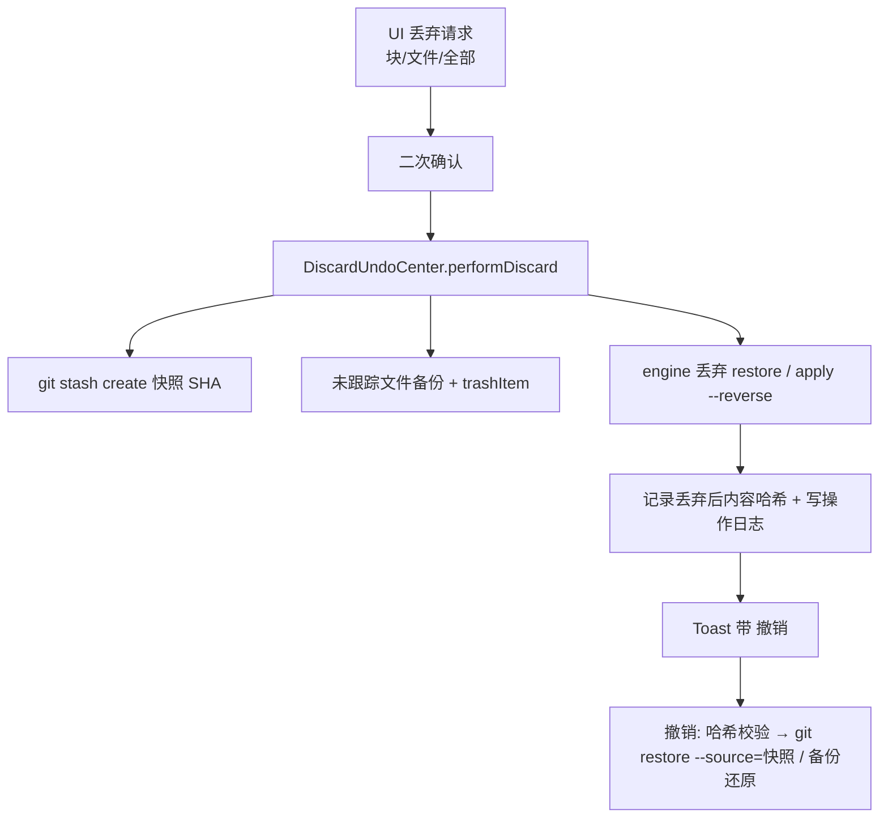
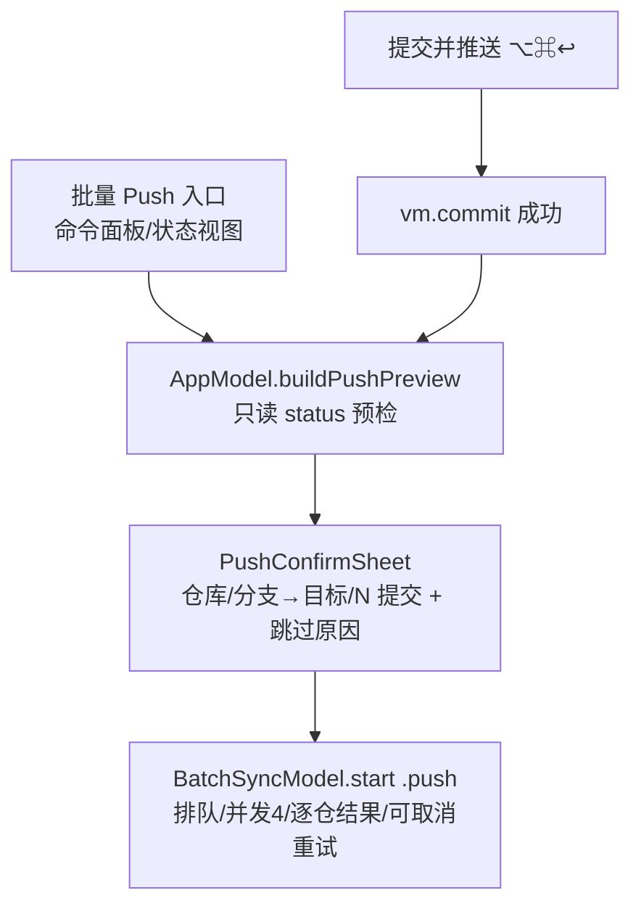

# Story-1031 批次 A 高优 P0 兑现·第一批（交互底座 + 看与改核心）设计文档

| 属性 | 内容 |
| --- | --- |
| 文档状态 | 实施中（方案事实源；实施总结见同目录 `summary.md`） |
| 目标版本 | v0.2.0（批次 A 第一批，并入 M1 至 M3 收尾） |
| 上游依据 | `docs/epic/INDEX.md` §6.1 批次 A；各 Epic 文档对应 Feature；MRD（文件 v2.0）10.2/10.4；TechStack v1.0（含 v1.1） |
| 范围声明 | 本 Story 只兑现 P0，不改 MRD 已承诺范围；与文档冲突处见 §6 |

## 1. 背景与目标

批次 A 名义 41 人周、30+ 项，按路线图拆批推进。本批先落地 **A1 交互底座 + A2 核心看与改**（17 项），把「看 diff、改代码、提交、推送、收尾合并」的完整手感补齐；A3 非功能与多工作区/DAG 等大件排下一 Story。

**目标（可判定）**：

1. `swift build` 零错误；`swift test`：既有 31 条 + 新增引擎等价性测试全绿。
2. 新增引擎能力全部以 git CLI 输出为等价性基准（blame ≡ `git blame --porcelain`、文件历史 ≡ `git log --follow`、块丢弃 ≡ 对选中块反向 apply、快照撤销后内容哈希与丢弃前一致、tag 推送后 `ls-remote --tags` 可见）。
3. 安全边界满足 MRD 10.2-G：永不 force（删远端 tag 走 `push --delete`）；块丢弃/取回旧版本/检出提交/删远端 tag 全部二次确认；新写命令全部经 `runWrite` 留痕。
4. 交互底座：菜单快捷键全量注册（EP12-F01）、提交行/文件行/Tag/Stash/仓库右键菜单（EP12-F02、EP02-F03）、⌘1-5 与提交 ⌘↩/⌥⌘↩。

**本批 Feature 清单**：

| Epic | Feature |
| --- | --- |
| EP12 | F01 菜单快捷键、F02 右键体系、F03 键盘导航（基础）、F09 设置扩展（P0 部分） |
| EP02 | F02 ref 徽标、F03 提交右键、F04 提交详情补全 |
| EP03 | F01 并排 diff、F02 行号/词级高亮/头部治理、F03 Blame、F04 文件历史 |
| EP04 | F01 丢弃补齐（块级+撤销+废纸篓）、F02 提交信息辅助、F03 提交并推送 |
| EP05 | F02 推送前确认、F03 分支一致性提示 |
| EP07 | F01 合并收尾、F02 外部合并工具、F03 两者都保留、F04 Stash diff、F05 Tag 推送 |
| EP09 | F01 在终端/编辑器打开 |

**顺延到下一 Story**：EP02-F01 DAG 提交图、EP05-F01 多仓框架完整化（预检快照回滚泛化）、EP01-F01/F02/F03 多工作区/标签页/凭据、EP12-F04 VoiceOver、F05 双语、F06 提交索引（GRDB，Story-1029 偏离项 1 待评审）、F07 匿名统计、F08 发布基础。

## 2. 架构设计

模块结构按 TechStack §9 不变，依赖方向单向；新增文件分布：

```text
Packages/GSGitEngine/Sources/GSGitEngine/
  GitRepository+History.swift   # blame / fileHistory / fileChangeAt / showFileContent
                                # / diffAgainstRevision / refsContaining / recentCommitSubjects
                                # / commitTemplate / conflictStageContents（新）
  GitRepository+Write.swift     # discardHunks / stashCreate / restoreFromSnapshot /
                                # trashUntracked / checkoutDetached / merge(message:) /
                                # pushTag(remote:) / deleteRemoteTag（扩展）
  Models.swift                  # BlameGroup/BlameInfo、ContainsRefs、CommitInfo committer 字段、
                                # DiffLine.oldNumber/newNumber（扩展）
  WordDiff.swift                # 行内词级差异（公共前缀/后缀裁剪，纯逻辑）（新）
  DiffParser.swift              # 行号计算、模式行解析（扩展）
Packages/GSFeatures/Sources/GSFeatures/
  DiscardUndoCenter.swift       # 丢弃快照与撤销（新）
  ExternalTools.swift           # 终端/编辑器/合并工具启动器（新）
  AppModel.swift                # Toast 动作、推送预检、AppSheet 扩展、MainTab 上移（扩展）
  RepoViewModel.swift           # 新能力透传（扩展）
App/Sources/GitSpaceApp/
  DiffFileView.swift            # 统一/并排、行号、词级高亮、文件标题栏（新，替代 DiffTextView 内部实现）
  BlameSheet.swift              # Blame 视图（新）
  FileHistorySheet.swift        # 文件历史（新）
  PushConfirmSheet.swift        # 推送确认（新）
  ExternalMergeTool.swift       # 外部合并工具流程（新）
  （WorkingView / RepoSheets / TimelineView / RootView / GitSpaceApp / SettingsView /
    StatusView / SidebarView / Components 局部扩展）
```

## 3. 关键设计决策

### 3.1 块级丢弃（EP04-F01）

- 引擎 `discardHunks(of:hunkIDs:)`：复用 `FileDiff.patch(selectingHunkIDs:)` 重组 patch → `git apply --reverse --whitespace=nowarn -`（只工作区，不动 index）。
- **丢弃前快照**：`git stash create <message>`（不改动工作区与任何 ref，TechStack §5 口径）；快照 SHA 写入操作日志。stash create 对纯未跟踪改动返回空——未跟踪文件走独立备份路径。
- **未跟踪文件**：先复制到 `~/Library/Application Support/GitSpace/discards/<uuid>` 备份，再 `FileManager.trashItem` 移入废纸篓；撤销时若原路径不存在则从备份还原，已存在则拒绝（与 tracked 口径一致）。
- **撤销校验**：丢弃完成时记录每个受影响路径的丢弃后内容哈希；撤销前重算，不一致（用户又改过）则拒绝并提示快照 SHA（EP04 状态表）。
- 撤销窗口：本会话内且 24 小时内（窗口长度为 MRD §17.2 新待定项，见 §6）。

### 3.2 推送确认（EP05-F02）

- 预检只读：对每个候选仓取 status（branch/upstream/ahead），无上游列「跳过」，不猜测目标。
- 确认框行式：`仓库 / 本地分支 → 上游 / N 提交`；N 取 `status.ahead`（porcelain v2 `# branch.ab`，与 `rev-list --count @{u}..HEAD` 同源，验收 MRD 10.4-13）。
- 执行走既有 `BatchSyncModel.start(.push)`（排队/并发/逐仓结果/重试复用）；永不 force，也不提供 `--force-with-lease`。
- 改目标与 push -u 首推属 EP05-F05（批次 B），本批不做（§5 简化项）。

### 3.3 外部合并工具（EP07-F02）

- 三路内容来自 `git show :1:path`（BASE）、`:2:`（LOCAL）、`:3:`（REMOTE），MERGED 即工作区文件本身。
- 模板按空白拆参（尊重引号）后逐参替换变量，**不拼接 shell 字符串**；进程用 `Process` 直启。
- opendiff 立即返回不阻塞：轮询 MERGED 文件冲突标记变化 + 提供手动「完成检查」按钮兜底；其余工具等待进程退出。
- 退出后统计 `<<<<<<<` 标记数：仍有标记只提示不标记解决；用户点「标记已解决」才 `git add`。

### 3.4 并排 diff（EP03-F01/F02）

- 行号在 DiffParser 解析 hunk 时按 `@@ -a,b +c,d @@` 计数写入 `DiffLine.oldNumber/newNumber`（raw 不变，patch 重组管线不受影响）。
- 并排模式：行配对算法——顺序扫描 hunk 行，del/add 相邻配对、单侧空白填充；两列各一个 NSTextView，共享滚动偏移同步。
- 词级高亮：`WordDiff` 公共前缀/后缀裁剪出差异区间；任一侧为整行增删（另一侧为空）时不做词级高亮。
- 上下文折叠：默认 `-U3` 时 hunk 间无大段未改行，折叠随 EP03-F05 上下文选项（批次 B）实现，本批不做。

### 3.5 交互底座（EP12-F01/F02/F03）

- 菜单快捷键在 `CommandMenu("操作")` 常驻注册，与命令面板共用 `AppModel` 方法；`MainTab` 枚举上移 GSFeatures，菜单可切视图。
- 右键菜单承载本批已实现能力：提交行（复制 SHA/信息、从此新建分支、在此打 tag、检出此提交）、文件行（Blame、文件历史、在编辑器打开、复制路径）、Tag 行（推送/删远端/删除）、Stash 行（Pop/Apply/丢弃）、仓库行（访达/终端/编辑器/复制路径/移除）。
- 检出此提交：`git switch --detach`，脏区预检 + detached 说明二次确认。

### 3.6 分支一致性（EP05-F03）

- 基准分支 = 当前有 branch 信息仓库中占比最多的分支（众数）；平票取第一个。固定基准的工作区设置顺延（§5）。
- 多仓状态顶部横幅「N 个仓不在 <基准> 上 [只看这些仓]」，点按过滤；行内徽标标注。

## 4. 数据流或调用链

丢弃撤销链路（EP04-F01）：



推送确认链路（EP05-F02 / EP04-F03）：



## 5. 简化项（相对 Epic 交互规格）

| # | 简化 | 原因 / 去向 |
| --- | --- | --- |
| 1 | 推送确认不支持改目标分支与 push -u 首推 | 属 EP05-F05（批次 B），本批仅对已配置上游仓确认推送 |
| 2 | 并排模式 hunk 操作按钮不在分隔条，与统一模式同置于 hunk 工具条 | 交互等价，视觉差异走查后再调 |
| 3 | diff 底部状态条无 ⌘↑/⌘↓ 快捷键（仅按钮） | 快捷键本体属 EP03-F05（P1 待评审） |
| 4 | 文件历史不含目录历史 | 无文件树与路径过滤入口（EP02-F05 批次 B） |
| 5 | 分支一致性基准只取众数，无固定基准设置 | 固定基准需工作区设置扩展，随 EP01 批次做 |
| 6 | 「提交信息历史」仅会话内草稿，不跨会话持久 | 跨会话持久化口径待 EP04 深化时定 |
| 7 | Blame 点击跳转仅限当前已加载时间窗内提交 | 全量定位依赖提交索引（EP12-F06） |
| 8 | 合并信息编辑框在 auto 快进场景显示但标注「快进时忽略」 | 预判是否产生合并提交需额外只读计算，收益低 |

## 6. 待评审项（不翻案，仅记录）

1. **EP12 文档与 epic INDEX 冲突**：`EP12-ux-foundation.md`（10-31 02:41）称菜单/右键/键盘/VoiceOver「已决策不做本期」，`INDEX.md` §6.1（02:01）批次 A 仍含 A1。本 Story 按用户锚定的 INDEX §6.1 恢复实施 A1 的菜单/右键/键盘导航（VoiceOver 属 A3 本就不在本批）。**EP12 文档需同步修订**，请评审确认以哪份为准。
2. 丢弃撤销快照保留窗口（会话 + 24h）——MRD §17.2 新待定项。
3. `--no-verify` 跳过钩子开关不提供（EP04 §6 待评审）。
4. 批量 push 一次确认（本批实现）vs 逐仓确认——MRD 17.2-6 待定，默认一次确认。
5. Tag 管理快捷键维持 ⌘⇧T（INDEX 决策点 #8 的 ⇧⌘G 调整与「恢复关闭标签 ⇧⌘T」绑定，标签页在下一 Story，届时一并调整）。

## 7. 测试策略

等价性基准 = git CLI 原始输出（GSTestSupport `GitShell` / `FixtureRepo`），swift-testing：

| 套件 | 断言要点 |
| --- | --- |
| BlameTests | 每行归属提交 ≡ `git blame --porcelain`；boundary 标记；连续行分组正确 |
| FileHistoryTests | 历史列表 ≡ `git log --follow --format=%H`（含重命名前）；fileChangeAt hunk ≡ `git show --format= --patch`；showFileContent ≡ `git show rev:path` |
| RefsContainingTests | ≡ `git branch -a --contains` / `git tag --contains` |
| HistoryWriteTests | checkoutDetached 后 HEAD detached；脏区被拒；merge(message:) 后 `log -1 --format=%B` ≡ 输入 |
| DiscardTests | discardHunks 后仅选中块回退；stashCreate 快照 → 丢弃 → 撤销后内容哈希 ≡ 丢弃前；trashUntracked 文件移除 |
| TagPushTests | 本地 bare origin：pushTag 后 `ls-remote --tags` 可见；deleteRemoteTag 后消失 |
| ConfigAndLogTests | commitTemplate ≡ `git config commit.template`；recentSubjects ≡ `git log --format=%s` |
| ConflictStagesTests | 三路内容 ≡ `git show :1/:2/:3 -- path` |
| WordDiffTests | 公共前缀/后缀区间正确；整行增删返回空 |
| CommitLogParserTests | committer 字段解析正确 |

UI 层沿用现口径不做单测，可视化由人走查（AGENTS.md §3）。
